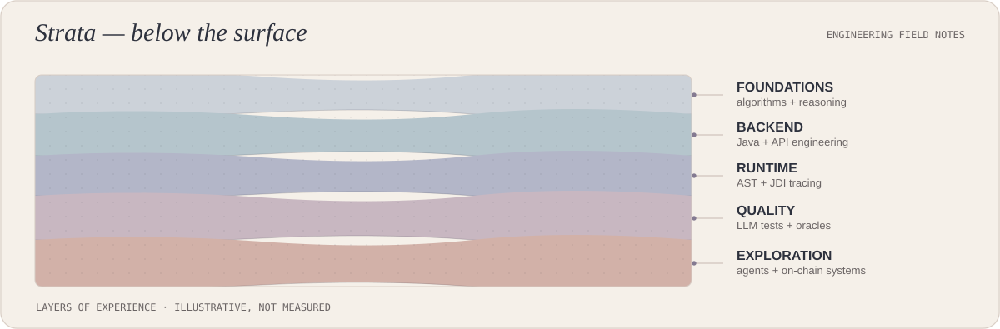
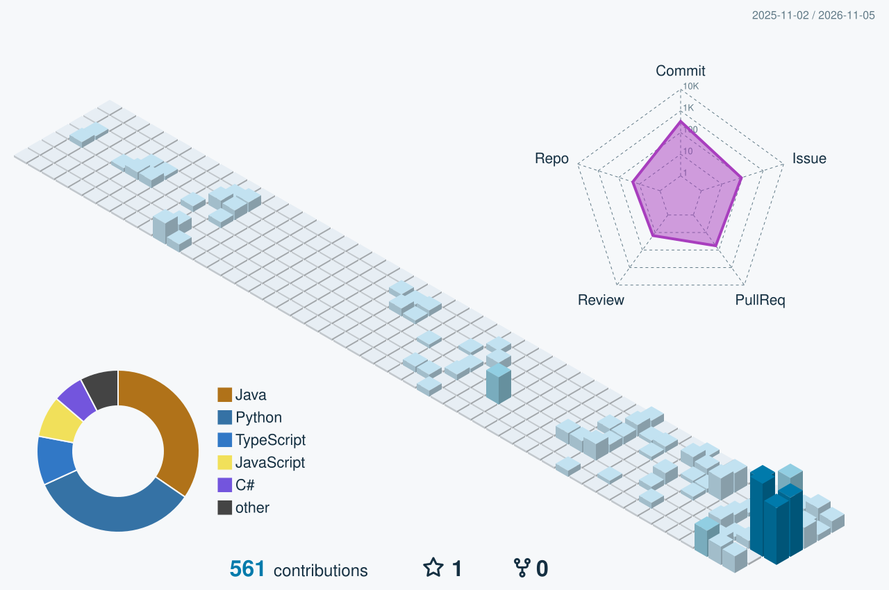

<!-- Final V2: immutable, self-hosted SVGs, pinned at 7777f9c63d549075656f0aa5438f20a4f793ed62 -->

<picture>
  <source media="(prefers-color-scheme: dark)" srcset="https://raw.githubusercontent.com/hienpham0344/hienpham0344/7777f9c63d549075656f0aa5438f20a4f793ed62/assets/profile-v2/hero-dark.svg">
  <source media="(prefers-color-scheme: light)" srcset="https://raw.githubusercontent.com/hienpham0344/hienpham0344/7777f9c63d549075656f0aa5438f20a4f793ed62/assets/profile-v2/hero-light.svg">
  
</picture>

SOFTWARE ENGINEERING @ UIT &nbsp; · &nbsp; JAVA BACKEND &nbsp; · &nbsp; AI RESEARCH

---

### 01 / A little about me

I'm **Hien**, a Software Engineering student at **UIT (VNU-HCM)**. I like the engineering questions that live just below the interface: how an API is structured, what a program does at runtime, and how we know a system actually works.

I primarily use **Java, Spring Boot, and PostgreSQL**, with an interest in AI-assisted engineering, software quality, and cloud deployment.

*Build. Learn. Improve.* — a working principle.

### 02 / Currently

**Building** — [AlgoViz](https://github.com/hienpham0344/AlgoViz), a learning platform with Java runtime tracing and a code judge.

**Investigating** — [Test Quality Lab](https://github.com/hienpham0344/Test-Quality-Lab), a work-in-progress platform for evaluating LLM-generated Python test suites.

**Exploring** — [SafeDeal](https://github.com/hienpham0344/SafeDeal), an early-stage AI-assisted escrow prototype on Avalanche.

---

<picture>
  <source media="(prefers-color-scheme: dark)" srcset="https://raw.githubusercontent.com/hienpham0344/hienpham0344/7777f9c63d549075656f0aa5438f20a4f793ed62/assets/profile-v2/strata-dark.svg">
  <source media="(prefers-color-scheme: light)" srcset="https://raw.githubusercontent.com/hienpham0344/hienpham0344/7777f9c63d549075656f0aa5438f20a4f793ed62/assets/profile-v2/strata-light.svg">
  
</picture>

### 03 / The log

I began with programming fundamentals, then became increasingly curious about what happens *underneath* an application. From backend engineering I moved into **Java AST analysis and JDI runtime inspection**; from execution tracing into questions about test quality and LLM-generated oracles.

*These strata are an illustration of interests, not a chart of commit counts.*

### 04 / Selected work

| Project | Purpose | Stack |
| :--- | :--- | :--- |
| **[AlgoViz](https://github.com/hienpham0344/AlgoViz)** | Learn algorithms through Java execution traces and a code judge. | `Java` `JDI` `React` |
| **[AST-tool](https://github.com/hienpham0344/AST-tool)** | Inspect Java syntax and local variables at runtime. | `JavaParser` `JDI` |
| **[AlgoLearner](https://github.com/hienpham0344/AlgoLearner)** | Classroom learning and online programming practice. | `Spring Boot` `TypeScript` |
| **[Agent-kit](https://github.com/hienpham0344/Agent-kit)** | Agent skills and engineering development workflows. | `Python` `Node.js` |
| **[Test Quality Lab](https://github.com/hienpham0344/Test-Quality-Lab)** | In development: evaluating LLM-generated tests. | `FastAPI` `React` |

### 05 / Toolkit

`Java` · `Spring Boot` · `PostgreSQL` · `Python` · `React` · `TypeScript` · `Docker` · `Azure` · `Git` · `Linux`

---

### 06 / Activity, in motion

<picture>
  <source media="(prefers-color-scheme: dark)" srcset="https://raw.githubusercontent.com/hienpham0344/hienpham0344/7777f9c63d549075656f0aa5438f20a4f793ed62/assets/profile-v2/contrib-3d-dark.svg">
  <source media="(prefers-color-scheme: light)" srcset="https://raw.githubusercontent.com/hienpham0344/hienpham0344/7777f9c63d549075656f0aa5438f20a4f793ed62/assets/profile-v2/contrib-3d-light.svg">
  
</picture>

<picture>
  <source media="(prefers-color-scheme: dark)" srcset="https://raw.githubusercontent.com/hienpham0344/hienpham0344/7777f9c63d549075656f0aa5438f20a4f793ed62/assets/profile-v2/snake-dark.svg">
  <source media="(prefers-color-scheme: light)" srcset="https://raw.githubusercontent.com/hienpham0344/hienpham0344/7777f9c63d549075656f0aa5438f20a4f793ed62/assets/profile-v2/snake-light.svg">
  
</picture>

Saved snapshots from November 5, 2026. Separate GitHub Actions workflows continue to produce current activity artwork.

---

*Not everything worth building needs to be loud.*

[GitHub](https://github.com/hienpham0344) &nbsp;·&nbsp; [Projects](https://github.com/hienpham0344?tab=repositories) &nbsp;·&nbsp; [AlgoViz](https://github.com/hienpham0344/AlgoViz)

