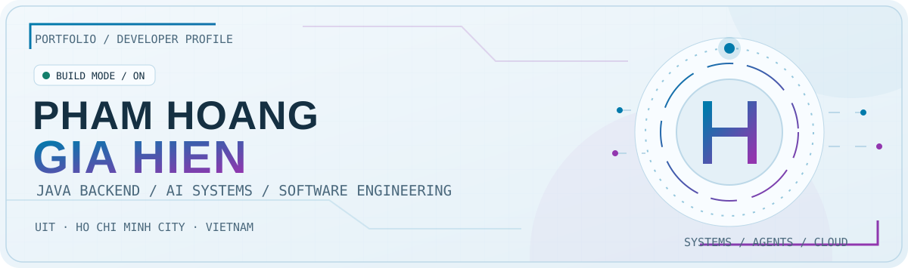
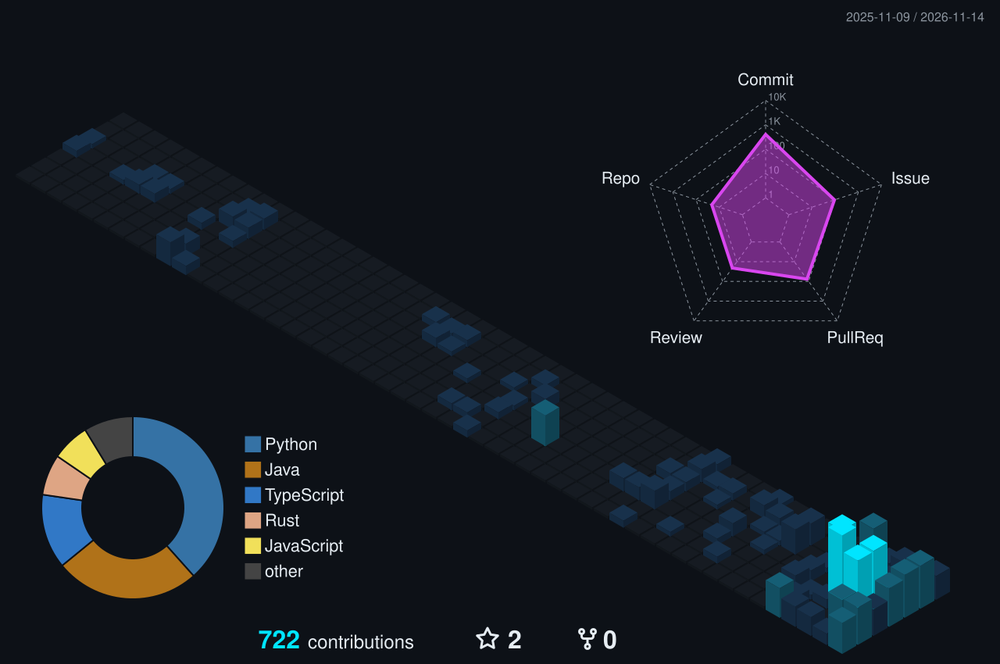

<!-- A custom GitHub profile, built around responsive SVG artwork and verified public projects. -->

<div align="center">

<picture>
  <source media="(prefers-color-scheme: dark)" srcset="./assets/profile-hero-dark.svg">
  <source media="(prefers-color-scheme: light)" srcset="./assets/profile-hero-light.svg">
  
</picture>

<picture>
  <source media="(prefers-color-scheme: dark)" srcset="./assets/logo-dark.svg">
  <source media="(prefers-color-scheme: light)" srcset="./assets/logo-light.svg">
  
</picture>

<p><strong>Software Engineering @ UIT · Java Backend · Building reliable systems & developer tools</strong></p>

<a href="https://github.com/hienpham0344?tab=repositories"></a>
<a href="https://github.com/hienpham0344/AlgoViz"></a>


</div>

---

### `01 / ABOUT THE BUILDER`

```yaml
name: Pham Hoang Gia Hien
university: University of Information Technology (VNU-HCM)
major: Software Engineering
core: [Java, Spring Boot, Backend Architecture, PostgreSQL]
interests: [AI Agents, Software Testing Research, DevOps, Developer Tools]
currently_building:
  - AlgoViz — algorithm learning and Java runtime tracing
  - Test Quality Lab — LLM-generated test evaluation
  - SafeDeal — AI-assisted escrow prototype on Avalanche
principle: "Build. Learn. Improve."
```

### `02 / ENGINEERING TOOLKIT`

<div align="center">


<sub>Backend first. Comfortable working across the stack.</sub>

</div>

### `03 / SELECTED BUILDS`

| Project | Purpose | Main technologies |
| :--- | :--- | :--- |
| **[AlgoViz](https://github.com/hienpham0344/AlgoViz)** | Explore algorithms using live Java runtime tracing and an online judge. | `Java` `Spring Boot` `JDI` `React` |
| **[AlgoLearner](https://github.com/hienpham0344/AlgoLearner)** | Classroom learning and LeetCode-style programming practice platform. | `Java` `PostgreSQL` `TypeScript` |
| **[Agent-kit](https://github.com/hienpham0344/Agent-kit)** | Engineering workflows, specialist agents and reusable AI skills. | `Python` `Node.js` `MCP` |
| **[Test Quality Lab](https://github.com/hienpham0344/Test-Quality-Lab)** | Work-in-progress platform for evaluating LLM-generated test suites. | `Python` `FastAPI` `React` |
| **[SafeDeal](https://github.com/hienpham0344/SafeDeal)** | In-development AI-assisted escrow application on Avalanche. | `Spring Boot` `Next.js` `Solidity` |

### `04 / GITHUB TELEMETRY`

<div align="center">

<picture>
  <source media="(prefers-color-scheme: dark)" srcset="https://github-readme-stats.vercel.app/api?username=hienpham0344&amp;show_icons=true&amp;theme=tokyonight&amp;hide_border=true&amp;bg_color=0D1117">
  <source media="(prefers-color-scheme: light)" srcset="https://github-readme-stats.vercel.app/api?username=hienpham0344&amp;show_icons=true&amp;theme=default&amp;hide_border=true">
  
</picture>

<picture>
  <source media="(prefers-color-scheme: dark)" srcset="https://github-readme-stats.vercel.app/api/top-langs/?username=hienpham0344&amp;layout=compact&amp;theme=tokyonight&amp;hide_border=true&amp;bg_color=0D1117">
  <source media="(prefers-color-scheme: light)" srcset="https://github-readme-stats.vercel.app/api/top-langs/?username=hienpham0344&amp;layout=compact&amp;theme=default&amp;hide_border=true">
  
</picture>

</div>

### `05 / CONTRIBUTION UNIVERSE`

<div align="center">

<picture>
  <source media="(prefers-color-scheme: dark)" srcset="https://raw.githubusercontent.com/hienpham0344/hienpham0344/output-3d-contrib/neon-contrib.svg">
  <source media="(prefers-color-scheme: light)" srcset="https://raw.githubusercontent.com/hienpham0344/hienpham0344/output-3d-contrib/neon-light.svg">
  
</picture>

<picture>
  <source media="(prefers-color-scheme: dark)" srcset="https://raw.githubusercontent.com/hienpham0344/hienpham0344/output/github-snake-dark.svg?v=20261106-2">
  <source media="(prefers-color-scheme: light)" srcset="https://raw.githubusercontent.com/hienpham0344/hienpham0344/output/github-snake.svg?v=20261106-2">
  
</picture>

<sub>Graphs are generated automatically using GitHub Actions. The activity shown reflects GitHub's available contribution data.</sub>

</div>

---

<div align="center">

<picture>
  <source media="(prefers-color-scheme: dark)" srcset="./assets/terminal-dark.svg">
  <source media="(prefers-color-scheme: light)" srcset="./assets/terminal-light.svg">
  
</picture>

<sub>Thanks for stopping by. Keep making things that matter.</sub>

</div>
