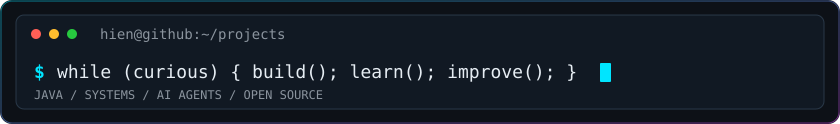

<!-- Inspired by the visual style of github.com/quackii00/quackii00. All profile content is personalized. -->

<div align="center">

  <a href="https://github.com/hienpham0344">
    
  </a>

  <p>
    <a href="https://github.com/hienpham0344"></a>
    <a href="https://github.com/hienpham0344?tab=repositories"></a>
    
  </p>

  

</div>

---

### About

```yaml
name: Pham Hoang Gia Hien
education: Software Engineering @ UIT (VNU-HCM)
focus: Java Backend Development, Software Architecture, Developer Tools
currently_exploring:
  - AI Agents & LLM-Based Software Testing
  - Cloud Deployment & DevOps
  - Blockchain Applications
working_on: [AlgoViz, AlgoLearner, SafeDeal, Test Quality Lab]
motto: "Build. Learn. Improve."
```

---

### Tech Stack

<div align="center">
  
</div>

---

### Selected Projects

| Project | What it does | Stack |
| :--- | :--- | :--- |
| **[AlgoViz](https://github.com/hienpham0344/AlgoViz)** | Algorithm learning platform with live Java runtime tracing, code execution and auto-judging. | Java, Spring Boot, JDI, React |
| **[AlgoLearner](https://github.com/hienpham0344/AlgoLearner)** | Programming education platform combining classroom management with online coding practice. | Spring Boot, React, TypeScript, PostgreSQL |
| **[SafeDeal](https://github.com/hienpham0344/SafeDeal)** | In-development AI-assisted escrow concept on Avalanche, with negotiation and warranty flows. | Java, Next.js, Solidity |
| **[Test Quality Lab](https://github.com/hienpham0344/Test-Quality-Lab)** | Work-in-progress platform for evaluating LLM-generated Python tests. | Python, FastAPI, React, PostgreSQL |
| **[Agent-kit](https://github.com/hienpham0344/Agent-kit)** | Agent skills, specialist roles and engineering workflows for AI-assisted development. | Python, Node.js, MCP |

---

### Contributions

<div align="center">

  <!-- Generated by .github/workflows/profile-3d.yml after the workflow runs on main -->
  

  <!-- Generated by .github/workflows/snake.yml after the workflow runs on main -->
  

  

</div>
