<!--
  Profile: Pham Hoang Gia Hien
  Original SVG artwork: Aurora Veil + Strata Core, inspired by
  https://github.com/beydemirfurkan/awesome-github-profile
  Assets are intentionally local for predictable GitHub rendering.
-->

<picture>
  <source media="(prefers-color-scheme: dark)" srcset="./assets/aurora-veil-dark.svg">
  <source media="(prefers-color-scheme: light)" srcset="./assets/aurora-veil-light.svg">
  
</picture>

SOFTWARE ENGINEERING @ UIT &nbsp; / &nbsp; JAVA BACKEND &nbsp; / &nbsp; DEVELOPER TOOLS

<table border="0" width="100%">
  <tr>
    <td valign="top" width="64%">

<h3>currently</h3>

I'm <strong>Hien</strong>, a Software Engineering student at <strong>UIT (VNU-HCM)</strong>. I build backend systems, algorithm-learning tools, and experiments that make complex software easier to understand.

My day-to-day work revolves around <strong>Java, Spring Boot, PostgreSQL</strong>, and the details that turn a prototype into something maintainable.

<h3>writing &amp; exploring</h3>

I think a lot about software quality: how code runs, how tests find failures, and how AI agents can support engineering without obscuring the evidence. Most of these ideas are taking shape as projects and research, rather than polished blog posts.

    </td>
    <td valign="top" align="right" width="36%">

 
<em>"Build. Learn. Improve."</em> 
— a working principle

<a href="https://github.com/hienpham0344">GitHub</a> 
<a href="https://github.com/hienpham0344?tab=repositories">All repositories</a> 
<a href="https://github.com/hienpham0344/AlgoViz">Currently building: AlgoViz</a>

    </td>
  </tr>
</table>

 

<picture>
  <source media="(prefers-color-scheme: dark)" srcset="./assets/strata-core-dark.svg">
  <source media="(prefers-color-scheme: light)" srcset="./assets/strata-core-light.svg">
  
</picture>

### the log

I started with the fundamentals of programming and gradually became more interested in what happens *underneath* an application: how an API is designed, how a program executes, and how we know its output is correct. That curiosity led from **backend engineering** to **runtime tracing**, **developer tooling**, and **LLM-generated test evaluation**. More recently, I've been experimenting with AI-assisted products and smart-contract workflows.

The layers above are a visual metaphor for these interests — **not a commit-count chart**.

### deepest layers

- **[AlgoViz](https://github.com/hienpham0344/AlgoViz)** — an algorithm-learning platform with live Java execution traces, runtime variable inspection, and automated code evaluation. Built with Java, Spring Boot, JDI, and React.
- **[Test Quality Lab](https://github.com/hienpham0344/Test-Quality-Lab)** — a work-in-progress system for studying the quality of LLM-generated Python test suites, including execution, coverage, mutation, and oracle effectiveness.

### other things I'm building

- **[AlgoLearner](https://github.com/hienpham0344/AlgoLearner)** — a platform for classrooms, courses, and programming practice.
- **[Agent-kit](https://github.com/hienpham0344/Agent-kit)** — reusable agent skills, workflows, and engineering helpers.
- **[SafeDeal](https://github.com/hienpham0344/SafeDeal)** — an early-stage exploration of AI-assisted escrow and warranty flows on Avalanche.
- **[AST-tool](https://github.com/hienpham0344/AST-tool)** — Java AST analysis and JDI-based runtime inspection.

### tools of the trade

Backend engineering first; learning across systems, cloud, and AI.

<strong>activity, in motion</strong> &nbsp;·&nbsp; contribution art &amp; GitHub stats

 

<picture>
  <source media="(prefers-color-scheme: dark)" srcset="https://raw.githubusercontent.com/hienpham0344/hienpham0344/output-3d-contrib/neon-contrib.svg">
  <source media="(prefers-color-scheme: light)" srcset="https://raw.githubusercontent.com/hienpham0344/hienpham0344/output-3d-contrib/neon-light.svg">
  
</picture>

<picture>
  <source media="(prefers-color-scheme: dark)" srcset="https://raw.githubusercontent.com/hienpham0344/hienpham0344/output/github-snake-dark.svg?v=20261106-3">
  <source media="(prefers-color-scheme: light)" srcset="https://raw.githubusercontent.com/hienpham0344/hienpham0344/output/github-snake.svg?v=20261106-3">
  
</picture>

<picture>
  <source media="(prefers-color-scheme: dark)" srcset="https://github-readme-stats.vercel.app/api?username=hienpham0344&amp;show_icons=true&amp;theme=tokyonight&amp;hide_border=true">
  <source media="(prefers-color-scheme: light)" srcset="https://github-readme-stats.vercel.app/api?username=hienpham0344&amp;show_icons=true&amp;theme=default&amp;hide_border=true">
  
</picture>

---

Not everything worth building needs to be loud.

 

<a href="https://github.com/hienpham0344">github.com/hienpham0344</a>

